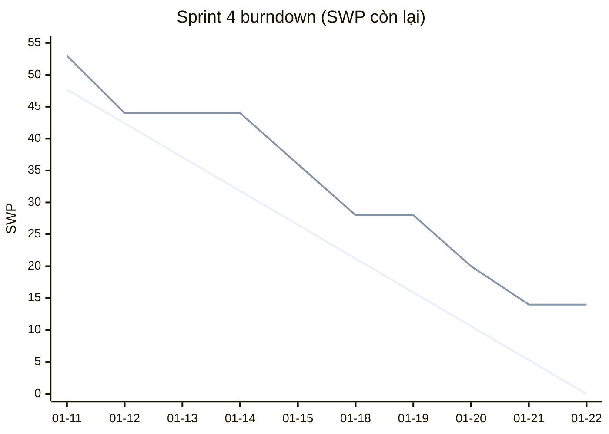

# Progress report — Sprint 4 (giả lập)

- **Iteration trên Project:** `Sprint 4` (trường Iteration của [Product A — LAB-5](https://github.com/users/pattc-1538/projects/1))
- **Khoảng thời gian giả lập:** 2027-01-11 (thứ Hai) → 2027-01-24; 10 ngày làm việc, báo cáo tại cuối ngày 2027-01-22
- **Phạm vi sprint:** 14 task phát triển của E-01 Master data (story E-01-S01 đến E-01-S04), 53 SWP / 132,5 giờ
- **Năng lực:** 1 BE + 1 FE (người phụ trách giả định), 80 giờ mỗi người. Kế hoạch BE 70 giờ, FE 62,5 giờ

> Đây là sprint giả lập để luyện báo cáo tiến độ. Trạng thái trên Project được đặt theo kịch bản bên dưới; dự án thật chưa bắt đầu.
> Giả định thêm: Sprint 1–3 (requirements và basic design, 50 task) đã xong đúng kế hoạch, nên đang ở trạng thái Done.

## 1. Trạng thái

| Trạng thái | Số issue | Tổng SWP | Ghi chú |
| --- | --- | --- | --- |
| Done | 10 | 39 | #5, #6, #7, #8 (E-01-S01); #14, #15 (E-01-S02); #21, #22 (E-01-S03); #28, #29 (E-01-S04, phần sửa code LAB-2) |
| In Review | 1 | 3 | #92 BE 許可承認要件: code xong 01-22, chờ review |
| In Progress | 1 | 3 | #94 FE 許可承認要件タブ: bắt đầu 01-22, chờ API của #92 |
| Todo | 2 | 8 | #93 BE 支払期限／完納奨励金率: **bị chặn**, chưa có giá trị ngày chốt và tỷ lệ từ khách. #95 FE: phụ thuộc #93 |
| **Tổng** | **14** | **53** | Hoàn thành 39/53 SWP (74%). 14 SWP chuyển sang Sprint 5 |

Story và epic: E-01-S01, S02, S03 đã xong phần phát triển nhưng vẫn **In Progress**, vì task ST nằm ở Sprint 10. E-01-S04 và epic #105 cũng đang In Progress.

## 2. Burndown

SWP còn lại vào cuối mỗi ngày làm việc. Đường kế hoạch giảm đều 5,3 SWP/ngày.

| Ngày | Kế hoạch | Thực tế | Hoàn thành trong ngày |
| --- | --- | --- | --- |
| 01-11 | 47,7 | 53 | — (việc lớn, kéo dài 2 ngày) |
| 01-12 | 42,4 | 44 | #5 BE データ層 (5), #7 FE 参加者台帳 (4) |
| 01-13 | 37,1 | 44 | — |
| 01-14 | 31,8 | 44 | — (#6 chậm: chờ quyết định Q-26) |
| 01-15 | 26,5 | 36 | #6 BE 許可承認手続き (5, trễ 1 ngày), #15 FE Shipper (3) |
| 01-18 | 21,2 | 28 | #8 FE 許可承認画面 (5, phải chờ API của #6), #14 BE Shipper (3) |
| 01-19 | 15,9 | 28 | — |
| 01-20 | 10,6 | 20 | #21 BE Item master (4), #22 FE Item master (4) |
| 01-21 | 5,3 | 14 | #28 BE パラメータ改修 (3), #29 FE タブ改修 (3) |
| 01-22 | 0 | 14 | — (#92 sang review, #94 bắt đầu, #93 bị chặn) |

**Thực tế lệch kế hoạch ở đâu:**
- **Đường thực tế đi ngang 3 ngày đầu (01-12 → 01-14),** vì các task của E-01-S01 đều 4–5 SWP và chỉ xong ở cuối mỗi task. Sprint không chậm lại ở đây; burndown theo SWP chỉ giảm theo bậc.
- **#6 trễ 1 ngày.** Thủ tục 許可/承認 phải chờ khách trả lời Q-26: ngưng tư cách và ngưng giấy phép có gộp làm một không. Đội làm theo cách tách riêng như story ghi, nên vẫn có rủi ro phải sửa lại.
- **FE chờ BE hai lần:** #8 chờ API của #6, #94 chờ API của #92. Lần này thứ tự BE→FE trong cùng story làm FE trống nửa ngày; sprint sau nên cho BE đi trước khoảng nửa ngày.
- **#93 bị chặn do thiếu dữ liệu, không phải do kỹ thuật.** Thiết kế bảng hạn thanh toán và tỷ lệ 完納奨励金 cần số thật của khách (story E-01-S04 §10 #5, #6). Đội không muốn làm theo số giả rồi sửa.
- **So với schedule.md:** E-01-S01 (01-11 → 01-15) và E-01-S02 (01-18) đúng hạn; E-01-S03 trễ 1 ngày (01-20 thay vì 01-19); E-01-S04 bắt đầu 01-21 thay vì 01-20 và chưa xong (kế hoạch kết thúc 01-27, ở Sprint 5).

## 3. Rủi ro trễ

| Rủi ro | Issue | Ảnh hưởng tới mốc nào | Hành động | Ai làm, khi nào |
| --- | --- | --- | --- | --- |
| Chưa có giá trị ngày chốt, số ngày tới hạn và tỷ lệ 完納奨励金 | #93, #95; sau đó #70, #77, #103 (E-04, Sprint 7–8) | M-04 Development complete (2027-04-07): E-04-S02, S03 cần tham số này | Thêm câu hỏi vào qa.md (QA-005) và hỏi trực tiếp ở họp tuần; trong lúc chờ, làm phần khung bảng và RPC không phụ thuộc giá trị | BrSE (Trần Thị Chăm Pa), gửi trong họp tuần 01-25; hạn trả lời 01-29 |
| 14 SWP (~35 giờ) chuyển sang Sprint 5, cộng với 6 task đã lên kế hoạch (E-01-S05, E-02-S01) | #92〜#95; #35, #36, #42, #43, #96, #97 | M-04: dùng buffer 15 ngày (03-17 → 04-07) | Đưa #92, #94 lên đầu Sprint 5; nếu Sprint 5 quá tải thì dời #96, #97 (hủy lô) sang Sprint 6 | PM (TBD), lúc lập kế hoạch Sprint 5 ngày 01-25 |
| Q-26 chưa trả lời: có thể phải sửa #6, #8 | #6, #8 (đã Done) | M-04, M-05 (ST E-01-S01 ở Sprint 10) | Hỏi khách cùng đợt QA-001〜004; ghi phần sửa có thể phát sinh vào story E-01-S01 §10 #3 | BrSE, gửi trước 01-29 |
| Q-22 (luồng ngoại lệ) chưa trả lời: có thể bỏ hoặc mở rộng #98〜#100 | #98, #99, #100 (Sprint 6) | M-04 | Cần câu trả lời trước khi Sprint 6 bắt đầu (02-08); nếu khách chọn "chặn tuyệt đối" thì bỏ 3 task (giảm 13 SWP) | BrSE hỏi, PM chốt phạm vi trước 02-05 |
| FE phải chờ BE trong cùng story | #94 (Sprint 5); các cặp BE/FE ở Sprint 5–8 | Năng suất sprint, chưa ảnh hưởng mốc | Ở Sprint 5, BE bắt đầu trước FE nửa ngày; FE làm trước phần giao diện với dữ liệu giả lập theo spec API | BE, FE, từ Sprint 5 |
